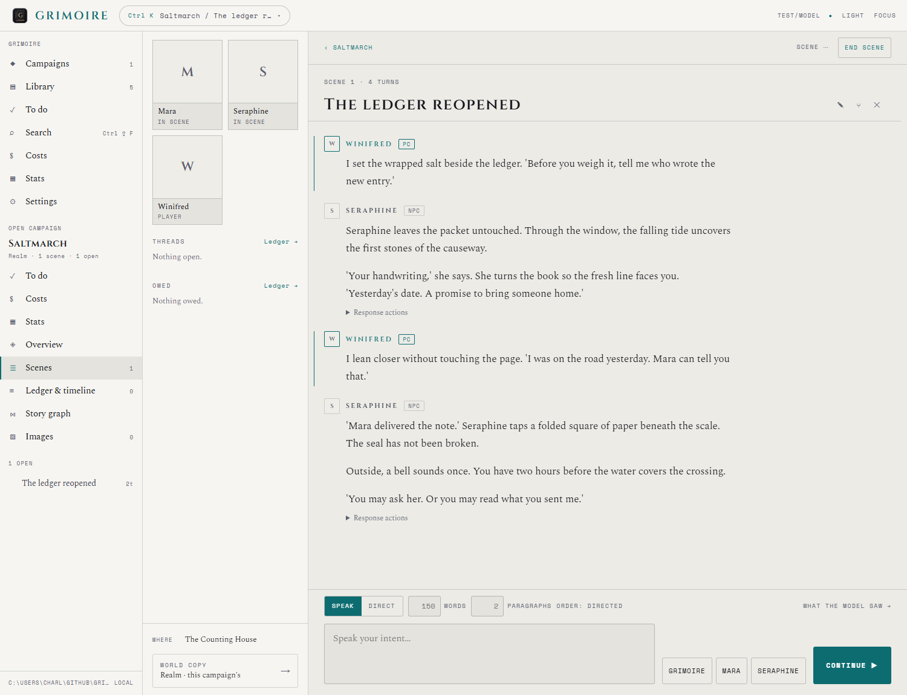
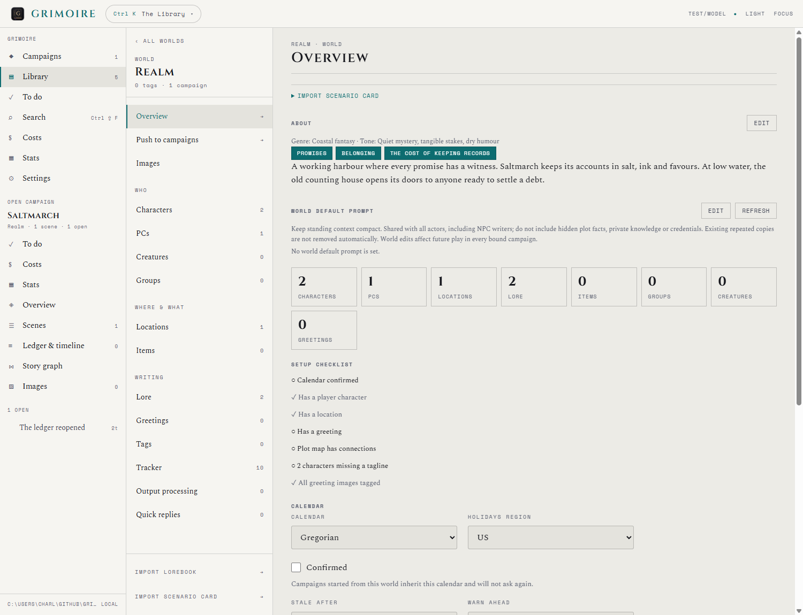
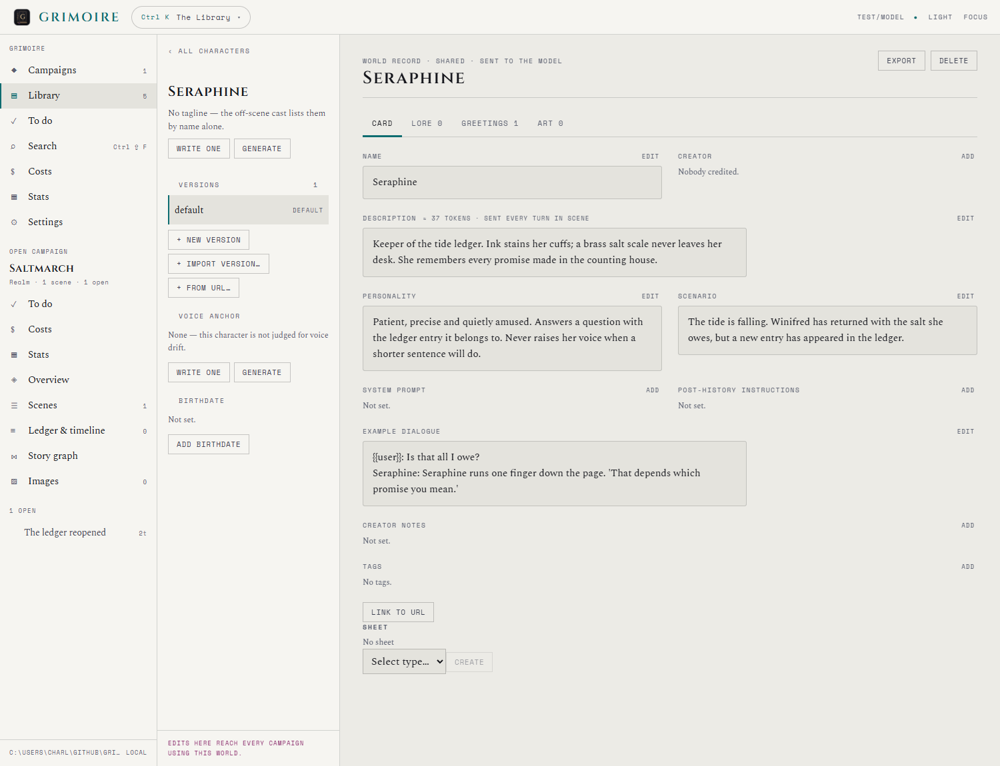
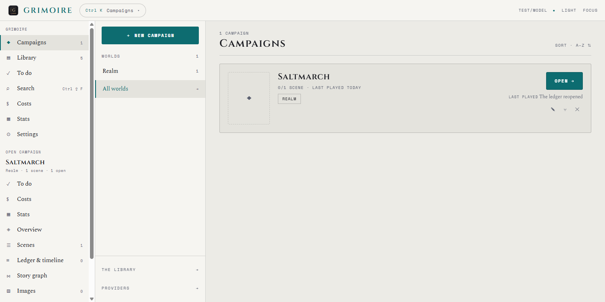

#  Grimoire

**A local-first app for collaborative storytelling and character roleplay with
language models.** Build a world, start a campaign, play scenes, and review what
each scene changes. Your library lives on your machine as Markdown, JSON and
images. Choose a hosted provider or an OpenAI-compatible local server.

**[Documentation](docs/README.md)** · **[Getting started](docs/guides/getting-started.md)** · **[Troubleshooting](docs/guides/troubleshooting.md)**

## Status

Grimoire is in active development. Worlds, campaigns, scene play, reviewed
wrap-up, imports, exports and the Android shell are implemented. These docs
describe the current application; the issue tracker holds ongoing work.

## A look at it

[](docs/screenshots/scene.png)

*A scene with its transcript, navigation and writing controls.*

| A world | A character |
|---|---|
| [](docs/screenshots/world-overview.png) | [](docs/screenshots/character-editor.png) |
| Browse the setting and its reusable records. | Read a character, then explicitly open its editor. |

[](docs/screenshots/campaigns.png)

All screenshots use an isolated library populated with synthetic test fixtures.
The [capture procedure](docs/screenshots/README.md) records their provenance.

## What the model saw

Open the scene inspector's **Context** section to inspect the assembled prompt,
its token estimates and any sections removed by a configured context budget.
**Turn history** opens retained prompt snapshots from earlier calls, so a past
reply can be inspected after the campaign has changed.

Use the stored entry when investigating a particular reply. Retention and the
limits of these records are explained in [Context and memory](docs/guides/context.md).

## What it does

- **Worlds** hold characters, player characters, locations, lore, items, groups,
  creatures, greetings and images. Reuse one setting across campaigns.
- **Campaigns** hold a playthrough: scenes, the chronicle, dossiers, facts,
  relationships, plot threads, commitments and in-world time. Campaign edits
  can diverge from the shared world.
- **Scenes** hold the conversation. Play with a PC or stage an offscreen scene,
  choose the cast, stream replies, steer rerolls and keep alternate responses.
- **Wrap-up** prepares a review of a completed scene. Inspect the proposed
  memory and state changes before saving them to the campaign.

See [Worldbuilding](docs/guides/worldbuilding.md) and
[Playing a campaign](docs/guides/playing.md) for the complete loop.

### Other highlights

- Import and export character cards; import world info and existing transcripts.
- Manage record art, with shared image descriptions and reusable images.
- Assign **Primary**, **Fast**, **Decision** and **Embedding** model roles,
  configure fallbacks, and override routes or campaign settings.
- Review continuity suggestions in the Ledger and explore the Story Graph.
- Inspect usage, latency and separately labelled cost figures.
- Use style guides, response presets, editable prompt templates and output rules.
- Roll dice, attach mechanics modules and edit character sheets.
- Use Gregorian, Hebrew or a custom calendar provider.
- Export campaigns, including EPUB books, and back up the library.

Details: [models](docs/guides/models.md), [context](docs/guides/context.md),
[data and backups](docs/guides/data.md), [mechanics](docs/reference/mechanics.md).

### Dice notation

The scene's dice control accepts expressions such as `2d6+3`, `4d6kh3`,
`5d6!`, `7d10t6` and `1d20+5 vs 15`. The
[dice reference](docs/reference/mechanics.md#dice-notation) explains the modifiers
and which combinations are valid.

## Requirements

- **Python 3.11+**
- **Node 24+**
- Access to a supported language model: a provider account, a local server, or
  the optional Claude subscription integration.

An OpenRouter key is needed only when using OpenRouter. Your chosen provider
receives the context sent to it; running the app locally does not make a hosted
model local. See [provider setup](docs/guides/models.md).

## Install

Clone the repository and run the installer for your platform.

**macOS / Linux**

```sh
git clone https://github.com/charlesmsiegel/grimoire.git
cd grimoire
scripts/unix/install.sh
```

**Windows (PowerShell)**

```powershell
git clone https://github.com/charlesmsiegel/grimoire.git
cd grimoire
scripts\windows\install.ps1
```

The installer creates the backend environment, installs dependencies, builds the
frontend and creates a launcher. It prints the resolved library location.
[Installation details](docs/guides/getting-started.md#install) include the optional
Claude integration and development tools.

## Run

**macOS / Linux:** `scripts/unix/run.sh`

**Windows (PowerShell):** `scripts\windows\run.ps1`

The normal launcher serves the built UI and API at **<http://127.0.0.1:8173>**.
Keep its terminal open; **Ctrl+C** stops it. The desktop launcher starts the same
application.

After `git pull`, the next normal launch rebuilds a stale UI. If rebuilding
fails, the launcher reports the failure and may serve the previous bundle;
rerun the installer to refresh dependencies.

For development, use `scripts/unix/run.sh --dev` or
`scripts\windows\run.ps1 -Dev`. The UI then opens at
**<http://127.0.0.1:5173>**, with the backend on 8173.

## First steps

1. Follow first-run setup: **Storage → Provider → Models → Look → World**.
2. Add characters, a PC and a location to the world. A greeting is a reusable
   opening, and is optional for a manually created scene.
3. Create a campaign from that world, choose the PC and open a scene.
4. Play a few turns. Open **Context** to inspect the prompt.
5. Finish the scene, review its wrap-up and save the changes you accept.

The [first-campaign walkthrough](docs/guides/getting-started.md#play-your-first-scene)
continues from a fresh installation.

## Local and OpenAI-compatible backends

Open **Settings → Inference → Providers**, create a provider, and choose its
preset. Ollama and LM Studio presets prefill their usual addresses; **Custom
(OpenAI-compatible)** accepts another server's base URL and optional key.

Then open **Models** and assign that provider and a model ID to a role. You can
mix local and hosted roles. [Provider setup](docs/guides/models.md#local-servers)
covers catalogs, capability tests, prompt compatibility and phone access.

## Where your data lives

The app resolves its library from `GRIMOIRE_HOME`, then the storage location
recorded in `~/.grimoire.json`, then `~/.grimoire`. **Configuration → Storage**
shows the current location and lets you choose another one. An environment
override takes precedence over the saved choice.

The library contains the records and images; disposable caches accelerate reads.
Provider settings and private story content belong in this library, outside the
public repository. Full backups should be treated as private too.

### What this cannot promise

Use one device at a time when sharing a library through a sync service, and let
sync finish before switching. Atomic record replacement and same-machine locks
help prevent partial or conflicting writes, but do not merge simultaneous edits
from separate devices or make a multi-file operation transactional.

Read [Data and backups](docs/guides/data.md) for everyday operations and the
[storage reference](docs/reference/storage.md) for the precise boundaries.

## Android app

The Android APK packages the same Python backend, React frontend and prompt
templates inside a Kotlin/WebView shell.

```sh
make android-bootstrap
make apk
make apk-install
```

The build needs additional Android tooling and Python 3.12. See the
[Android reference](docs/reference/android.md) for prerequisites, outputs,
device storage and access to a model server on another machine.

## Development

Start with [CONTRIBUTING.md](CONTRIBUTING.md) for setup and `make check`.
[AGENTS.md](AGENTS.md) owns coding conventions and routes agents to the
[development skill](.agents/skills/grimoire-development/SKILL.md).

| Directory | Contents |
|---|---|
| `backend/` | FastAPI app, file store, model adapters and pytest suite |
| `frontend/` | React/Vite interface and Vitest suite |
| `templates/` | Jinja prompt templates; [template reference](templates/README.md) |
| `android/` | Kotlin shell and APK packaging |
| `scripts/` | Installation, launch, checks and device utilities |
| `evals/` | Offline replay and opt-in live evaluations |
| `docs/` | Current user guides and technical references |

The [architecture map](docs/reference/architecture.md) explains the main flows;
the [development reference](docs/reference/development.md) explains source
navigation and verification.

## License

[Apache-2.0](LICENSE).

## Related

- [hardy](https://github.com/charlesmsiegel/hardy) — proof artifacts and verification.
- [ludex-rpg](https://github.com/charlesmsiegel/ludex-rpg) — roleplaying tools.
- [coding-skills](https://github.com/charlesmsiegel/coding-skills) — code analysis skills.
- [rpg-bookbinder](https://github.com/charlesmsiegel/rpg-bookbinder) — stories stored as files.
