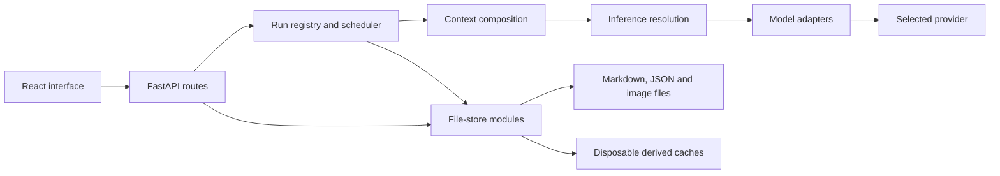

# Architecture

[Documentation](../README.md) · [Development](development.md) · [Storage](storage.md)

## Components

Grimoire has one Python application and one web interface. Desktop runs FastAPI
on loopback and serves the built frontend. Development adds Vite and its API
proxy. Android embeds the same application and bundle behind a Kotlin/WebView
shell. It does not maintain a separate implementation of the story engine.

| Component | Responsibility | Start reading |
|---|---|---|
| App assembly | Lifespan, middleware, dependencies and static serving | [main.py](../../backend/src/grimoire/main.py), `create_app` |
| HTTP domains | Request validation, operation boundaries and responses | [routes package](../../backend/src/grimoire/routes/__init__.py) |
| Run ownership | Reservation, status, subscribers and cancellation | [runs/](../../backend/src/grimoire/routes/runs/) |
| Scheduling | Worker-to-loop bridge and guarded execution | [runner.py](../../backend/src/grimoire/runner.py) |
| Store | Domain reads/writes, overlays, locks and identity | [store package](../../backend/src/grimoire/store/__init__.py) |
| Composition | Gather, render, pack and freeze prompt inputs | [context assembly](../../backend/src/grimoire/store/context/assemble/) |
| Inference | Resolve work to typed attempts and dispatch operations | [resolver](../../backend/src/grimoire/store/inference/resolve/), [operations](../../backend/src/grimoire/inference/) |
| Providers | Protocol-specific requests and response parsing | [adapter registry](../../backend/src/grimoire/adapters.py) |
| UI routing | Screens and scene/record addresses | [App.tsx](../../frontend/src/App.tsx) |

## A scene turn

1. The play view posts the player's action to the scene routes. The route checks
   the campaign, scene and usable inference selection before starting the work.
2. A run reserves the scene's current identity. The request can subscribe to
   streamed frames without owning the lifetime of generation.
3. Character-turn orchestration selects the next contribution, gathers its
   context and composes the prompt for that speaker. Historical evidence is
   filtered for the reader it will be sent to.
4. The inference operation dispatches typed provider/model attempts. Metering
   records the calls; prompt capture records the prepared composition.
5. Terminal persistence checks the scene identity and current run state under
   the relevant lock. A landed turn can schedule its own background follow-ups.

Read [scene routes](../../backend/src/grimoire/routes/scenes/),
[character turns](../../backend/src/grimoire/routes/character_turns/),
[streaming persistence](../../backend/src/grimoire/routes/streaming/) and
[history gathering](../../backend/src/grimoire/routes/history_recall.py).

## A scene wrap-up

Preparing wrap-up starts a review run. Absorb and its related phases compute a
review payload rather than directly accepting every proposed change. The pending
review survives navigation. Saving the reviewed result checks its freshness and
applies campaign changes through the store's commit/undo machinery.

Continuity reconciliation can run after a completed save. Its findings are
reviewed separately before merges, links or closures are applied. Discovery and
projection readers do not gain permission to edit ledger records.

Start with [absorb](../../backend/src/grimoire/store/absorb/),
[pending reviews](../../backend/src/grimoire/store/pending_reviews.py),
[commit state](../../backend/src/grimoire/store/commits.py) and
[continuity routes](../../backend/src/grimoire/routes/continuity.py).

## Reads and derived data

Files define the live library. Overlay resolution makes campaign records take
precedence over their world without requiring a complete copy. File signatures,
projection memos and the optional compiled cache reduce repeated work. Cache
misses fall back to the underlying readers; a database row is not authority for
whether a world, scene or record exists.

[Storage contracts](storage.md) describes where this does and does not provide
consistency. [Context and memory](../guides/context.md) describes what these
readers assemble for the user.

## Interfaces and boundaries

- React uses the API client in [frontend/src/api/](../../frontend/src/api/).
- Routes own HTTP semantics; store modules own persistence and invariants.
- Inference routing selects a provider/model/preset independently of the UI.
- Adapters handle provider protocol differences; task call sites use the shared
  inference operation rather than calling an adapter directly.
- Jinja templates own prompt rendering; the composed prompt is the unit the
  inspector can explain.
- Repository documentation is not an input to application behavior or tests.

FastAPI exposes the running app's generated OpenAPI description at
`/openapi.json` and interactive API page at `/docs`. Those routes are generated
from code and do not read this repository's `docs/` directory.
